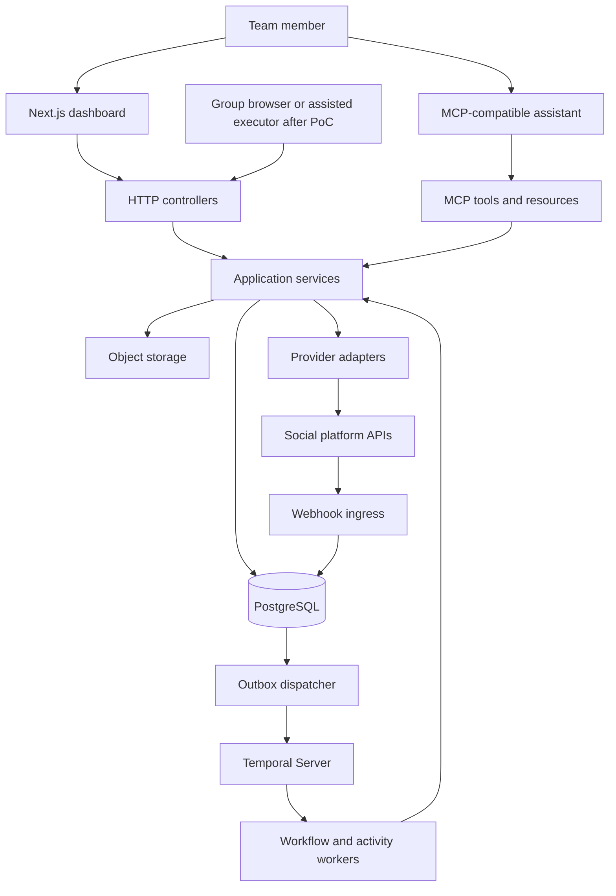
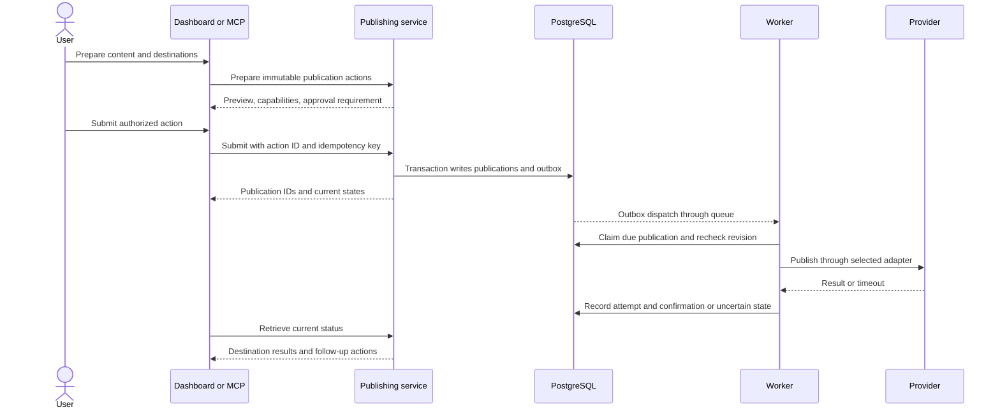

# Social Media Automation architecture design

Design date 12 November 2026. Proposed implementation design for the internal tool. Platform capabilities, framework versions, and hosting require validation.

## Product entry points

The team works through a dashboard and can use an MCP-compatible assistant to perform authorized actions. Both entry points call shared application services. Temporal coordinates durable publishing workflows; workflow and activity workers execute provider operations. PostgreSQL remains the source of truth for business records and user-facing publication status.

The dashboard has six primary screens.

| Screen                    | Main actions                                                                                                       |
| ------------------------- | ------------------------------------------------------------------------------------------------------------------ |
| Accounts and destinations | Connect accounts, reconnect expired grants, inspect capabilities, choose Page/Profile identities and destinations. |
| Content library           | Upload and reuse media, captions, and templates.                                                                   |
| Composer                  | Select content, edit destination variants, preview, submit for approval, publish, or schedule.                     |
| Calendar and history      | Inspect each destination's status, attempts, errors, approval state, and publication URL.                          |
| Comment inbox             | Read supported threads, draft replies, approve, and send.                                                          |
| Analytics                 | Inspect available account/post metrics, freshness, and optional seven-day comparisons.                             |

## System shape



One repository contains three application entry points, web, API, and worker. HTTP controllers, webhook ingress, and MCP transport initially live in the API process. A modular backend package supplies application services to API and worker. A later deployment can scale workers independently.

The server supports MCP clients. An embedded content assistant, if built, can call the same application services through controlled tool bindings. Its use of a network MCP client is optional and depends on whether it needs external MCP servers.

## Stack proposal

TypeScript is confirmed as the implementation language because it is the team's primary language. Use it across the dashboard, API, workers, MCP layer, provider adapters, and shared contracts. Enable strict type checking when scaffolding. Framework and infrastructure selections remain proposals.

The local Celesnity workspace at `D:\Celestiny` supplies evidence for team alignment. `celesnity-web/package.json` declares Next.js 16.3.8, React 19.2.8, TypeScript 5.9.3, Tailwind CSS 4, Zustand 5, and Zod 4. Its App Router layout confirms framework usage. `celesnity-core/package.json` declares NestJS 11.2.7, Prisma 7.9.1, `pg`, and the MCP SDK, with NestJS API and worker entry points. The agent also declares TypeScript, NestJS, MCP, and PostgreSQL-related libraries. These observations support the proposed frontend/backend frameworks through existing team experience. Exact versions require compatibility review before adoption.

| Component                           | Proposed choice                                            | Responsibility                                                                                                                                                             |
| ----------------------------------- | ---------------------------------------------------------- | -------------------------------------------------------------------------------------------------------------------------------------------------------------------------- |
| Language and workspace              | TypeScript confirmed; npm monorepo layout established      | Team familiarity, shared contracts, and reproducible dependencies. Node.js 24.14.0 and npm 11.21.1 are pinned for development tooling.                                     |
| Web                                 | Next.js, React                                             | Dashboard and authenticated browser session.                                                                                                                               |
| Backend                             | NestJS                                                     | HTTP, webhooks, authorization, modules, and worker composition.                                                                                                            |
| Agent interface                     | Official MCP TypeScript SDK, authenticated Streamable HTTP | Remote tool discovery, invocation, and context retrieval. Select a compatible protocol/SDK version during the PoC.                                                         |
| Database                            | PostgreSQL                                                 | Durable business state, constraints, attempts, outbox, and synchronization cursors.                                                                                        |
| Database access                     | Prisma candidate                                           | Migrations and typed queries, subject to transaction/concurrency evaluation.                                                                                               |
| Workflow engine                     | Temporal selected                                          | Durable scheduled publishing, per-destination progress, pending-result checks, retry coordination, and execution history.                                                  |
| Temporal persistence and visibility | Self-hosted Temporal with PostgreSQL selected              | Store workflow state/history and searchable execution visibility. Use a separate Temporal database; Elasticsearch is not required for the planned supported configuration. |
| Media                               | S3-compatible storage; MinIO candidate                     | Original assets and derived media where needed.                                                                                                                            |
| Browser                             | Playwright candidate                                       | Application UI verification and scoped Group experiments.                                                                                                                  |
| Local services                      | Docker Compose candidate                                   | Reproducible application and dependency setup.                                                                                                                             |

Temporal records workflow progress and resumes durable executions; the application still supplies domain rules for publication verification, safe provider retries, and product-facing status. [Temporal workflows](https://docs.temporal.io/workflows), [Temporal Visibility](https://docs.temporal.io/visibility)

### Self-hosted production operations

Operate Temporal Server, its PostgreSQL persistence/Visibility database, and the separately deployed application workers. Keep application business data in its own PostgreSQL database and media/extracted files in MinIO. The team owns database backups and restore exercises, service/database monitoring and alerts, TLS and access controls, upgrades, capacity planning, and incident recovery. Production redundancy depends on agreed uptime and recovery objectives. Docker Compose is for local development and does not provide production high availability.

## Module ownership

| Module       | Owns                                                                                           |
| ------------ | ---------------------------------------------------------------------------------------------- |
| Access       | Internal users, application roles, account grants, authorization context, audit events.        |
| Connections  | Social authorization flows, encrypted credentials, refresh, revocation, publishing identities. |
| Destinations | Feeds, Groups, communities, identity eligibility, operation capabilities.                      |
| Content      | Media assets, drafts, immutable versions, destination variants.                                |
| Publishing   | Approvals, schedules, publications, attempts, reconciliation, assisted tasks.                  |
| Engagement   | Threads, comments, reply drafts, reply approvals, delivery attempts.                           |
| AI           | Brand policy, contextual generation, reply-mode policy, generation records.                    |
| Analytics    | Provider metric definitions, snapshots, availability, freshness.                               |
| Integrations | Provider adapters, webhook normalization, pagination, provider error classification.           |

Each module exposes application operations with explicit inputs and results. Transport handlers validate requests, resolve the caller, invoke an operation, and serialize its result. Provider adapters handle provider-specific requests and normalization.

## Data model

| Record                        | Essential fields and relationships                                                                            |
| ----------------------------- | ------------------------------------------------------------------------------------------------------------- |
| User and account grant        | Internal identity, role, permitted social identities, allowed operations.                                     |
| Connection                    | Provider, authorizing user, encrypted credential reference, granted scopes, expiry, refresh version, status.  |
| Social identity               | Connection, provider identity ID, Page/Profile/company type, display name.                                    |
| Destination and eligibility   | Provider destination ID/type, identity, publishing mode, capability status, checked time, reason.             |
| Media asset                   | Storage key, MIME type, size, dimensions/duration, processing status, uploader.                               |
| Post and content version      | Draft owner, immutable version ID, caption, ordered media references.                                         |
| Publication                   | Version/variant, identity, destination, schedule, revision, state, provider post ID/URL, confirmation source. |
| Approval                      | Action, exact content version, identity, destination, policy version, approver, decision, decision time.      |
| Publication attempt           | Publication, operation key, attempt number, lease/fencing token, start/end, redacted error, outcome.          |
| Assisted task                 | Publication, assigned user/executor, action required, submitted evidence, verification state.                 |
| Thread and comment            | Provider IDs, identity, publication, parent comment, author, body, provider update time.                      |
| Reply action                  | Comment, immutable reply text, policy/approval, operation key, delivery state, provider reply ID.             |
| Metric snapshot               | Identity/post, provider metric name, value/unit, period, measured/fetched time, availability reason.          |
| Webhook inbox and sync cursor | Provider, connection, event key, raw payload retention, processing state, last completed cursor.              |
| Outbox and audit event        | Durable operation/event, correlation ID, dispatch state, actor and action metadata.                           |

Provider IDs are scoped by provider and identity where required. Unique constraints protect event ingestion and operation keys. An explicit new-publication operation creates an intentional repost. Repeating the same idempotency key returns the existing result, and a changed payload under that key produces a conflict.

## MCP contract

MCP exposes tools, resources, and reusable prompts to clients. Tool names and schemas below are proposed application contracts. [MCP architecture](https://github.com/modelcontextprotocol/modelcontextprotocol/blob/main/docs/specification/2026-07-28/architecture/index.mdx)

| Tool                     | Inputs                                                 | Result                                                              |
| ------------------------ | ------------------------------------------------------ | ------------------------------------------------------------------- |
| `list_destinations`      | Provider/identity filters, cursor                      | Eligible destinations, capability evidence, pagination cursor.      |
| `create_draft`           | Caption, asset IDs, variants, idempotency key          | Draft ID and version.                                               |
| `prepare_publications`   | Draft version, identity/destination pairs, schedule    | Immutable action preview, validation results, approval requirement. |
| `submit_publications`    | Prepared action ID, expected revision, idempotency key | Publication IDs and initial states.                                 |
| `get_publication_status` | Publication IDs                                        | Current states, confirmation source, URL, required intervention.    |
| `cancel_publication`     | Publication ID, expected revision                      | Cancellation result or current in-flight state.                     |
| `list_comments`          | Identity/post filters, cursor                          | Authorized comments and reply state.                                |
| `create_reply_draft`     | Comment ID, reply text, idempotency key                | Reply draft and approval requirement.                               |
| `submit_reply`           | Reply draft ID/version, idempotency key                | Durable reply action ID and delivery state.                         |
| `get_metrics`            | Identity/post IDs, metric names, time window           | Available values, definitions, freshness, availability reasons.     |

Resources expose authorized brand guidance, draft previews, and capability records. Asset inputs use existing asset IDs and controlled uploads. Every read applies the caller's grants. Tool results exclude credentials and browser session material.

The backend resolves approval from stored policy and the authenticated actor's permissions. Approval records bind the exact content and destinations. Content changes invalidate the corresponding approval. Scheduling edits re-run schedule validation and applicable approval policy. A model-supplied confirmation flag cannot grant approval.

MCP access tokens authorize access to this application. Social-provider grants are obtained and stored separately for downstream calls. [MCP authorization](https://github.com/modelcontextprotocol/modelcontextprotocol/blob/main/docs/docs/2026-07-28/tutorials/security/authorization.mdx)

## Publishing flow



The database stores scheduled time in UTC and retains the chosen IANA timezone for display and schedule interpretation. An outbox dispatcher starts Temporal workflows with stable workflow IDs after the publication transaction commits. The workflow rechecks schedule, revision, authorization, and capabilities before executing activities.

Publication delivery progresses through `scheduled`, `submitting`, `submitted_unverified`, `pending_approval`, `published_confirmed`, `rejected`, `failed`, or `cancelled`. Approval inside our tool is recorded separately from external Group administrator approval.

Provider acceptance may leave a publication unverified until read-back, webhook, or an authorized manual confirmation supplies evidence. Confirmation records identify their source and time. A permalink alone is evaluated according to provider behavior. Each destination retains its own result.

## Failure and concurrency behavior

| Situation                                         | Required behavior                                                                                                                |
| ------------------------------------------------- | -------------------------------------------------------------------------------------------------------------------------------- |
| Database commit succeeds and queue dispatch fails | Retry the durable outbox entry. A periodic scan recovers overdue undispatched work.                                              |
| Duplicate delivery or concurrent workers          | Use unique operation keys and an atomic claim. Fencing checks prevent stale attempts from updating current state.                |
| Worker dies during a provider call                | Mark expired in-flight work uncertain and reconcile before another submission.                                                   |
| Provider call times out after submission          | Persist `submitted_unverified`. Read back or request intervention when the provider offers insufficient evidence for safe retry. |
| Known transient rejection before acceptance       | Retry with bounded backoff, jitter, and provider rate-limit timing.                                                              |
| Token expires or is revoked                       | Refresh under connection-level concurrency control, or surface reconnection required. Recheck authorization before continuing.   |
| Schedule edited while an older job exists         | Increment revision. Older jobs exit after checking current revision.                                                             |
| Cancellation races with publishing                | Record cancellation atomically when possible. An in-flight submission needs reconciliation and may still publish.                |
| Webhook is duplicated, delayed, or reordered      | Persist and deduplicate ingress, process asynchronously, and reconcile provider state.                                           |
| Polling fails partway through pagination          | Commit records and cursor progress consistently so retry preserves coverage.                                                     |

A database claim cannot prevent an external provider from completing a request after our worker fails. Recovery must account for the provider's idempotency and read-back capabilities.

## Provider adapter contract

Adapters implement only the operations established by capability research and live access checks. Candidate operations are authorization, token refresh, identity discovery, destination discovery, content validation, media preparation, publication submission/read-back, comment listing, reply submission/read-back, metrics retrieval, and webhook verification/normalization.

Every operation returns normalized results with provider identifiers, status, redacted diagnostics, retry guidance, and confirmation evidence where available. Capabilities distinguish documented support, tested access, denied access, unsupported behavior, and unknown status. They retain format limits and checked time.

Coverage includes Facebook, LinkedIn, Medium, X, Substack, Instagram, TikTok, Threads, Bluesky, and Reddit. Facebook Groups use their own execution path under Facebook. Their operational support remains subject to the Group PoC and current provider verification.

## Facebook Groups execution

The dashboard records the selected Group and publishing identity, whether the action creates a post or shares an existing post, and whether that identity is eligible. The executor receives the exact approved action and returns submission evidence.

The PoC selects browser, extension, or assisted execution based on actual account/session requirements and observable outcomes. Pending approval remains visible as pending. An unknown result generates a reconciliation or human-verification task. Manual fallback uses the same publication history and confirmation fields.

Browser state is stored with restricted access and excluded from source control. The executor authenticates to our API and can report outcomes only for assigned work. Browser documentation describes authenticated state handling. [Playwright authentication](https://playwright.dev/docs/auth)

## Comments, AI replies, and analytics

Verified webhooks or polling update normalized threads. A reply request resolves brand rules and conversation context, generates or accepts a draft, applies approval/auto-mode policy, and creates a durable reply action. Attempts use the same uncertain-result handling as publications.

Treat comment text and retrieved platform content as untrusted input. Tool permissions, approval rules, allowed identities, and reply limits remain server-enforced. Record prompt/policy version and reply provenance, prevent self-reply loops, and surface cases requiring review.

Metric collection stores provider definitions and time windows. The dashboard distinguishes zero from unavailable, delayed, and permission-limited values. Seven-day reports require an agreed comparison window and handling of missing baselines.

## Established repository layout

```text
apps/
  web/                     Dashboard
  api/                     HTTP, MCP, OAuth callbacks, webhooks
  worker/                  Scheduler, outbox, publishing, sync, reconciliation
packages/
  backend/                 Domain modules, application services, adapters, persistence
  contracts/               Validated transport schemas and public result types
infra/                     Compose and service configuration
docs/
  architecture/            System design
  plans/                   Implementation planning
  guides/                  Development procedures
  references/              External source findings
  decisions/               Architecture decisions
```

Backend imports remain server-side. The dashboard consumes public contracts. API and worker compose the same backend modules through their entry points. The directory boundaries are established; source scaffolding is pending. Detailed file placement is recorded in [workspace-layout.md](../workspace-layout.md).

## Reference review and first implementation boundary

The focused local Postiz source findings are recorded in [Postiz reference review](../references/postiz/reference-review.md). The end-to-end source trace is in [Postiz deep dive](../references/postiz/deep-dive.md). Together they show how the composer, API, shared services, PostgreSQL, Temporal workflow/activity workers, provider adapters, and MCP tool connect. They also identify the weak database-to-workflow dispatch boundary, differences in Group semantics, comment ingestion, storage, and durable publication states.

Celesnity informed the convention and dependency-boundary comparison. Its manifests and entry points were inspected locally; the project rules are self-contained in the root AGENTS.md. Runtime correctness and suitability of individual reusable components require focused review.

Postiz is a source reference for composer behavior, provider settings and validation, OAuth identities, media publishing, pending processing, scheduling, recovery, and MCP reuse of application services. The trace documents patterns to adapt and weaknesses not to copy, including best-effort workflow start after persistence and compact publication states. License implications still apply before copying source. [Postiz source](https://github.com/gitroomhq/postiz-app)

The first proposed application slice is an authorized test Page connection, one image-and-caption draft, immediate/scheduled publication, read-back, and destination history. The dashboard and a small MCP tool set exercise the same application operations. The Group feasibility experiment advances alongside this slice and informs its production execution design.

Before selecting exact dependencies and scaffolding, resolve hosting and identity-provider needs, perform the focused reference review, and validate the critical provider flows. This design is based on workflow analysis and documentation review. Runtime behavior, API access, Group execution, and framework compatibility remain untested.
