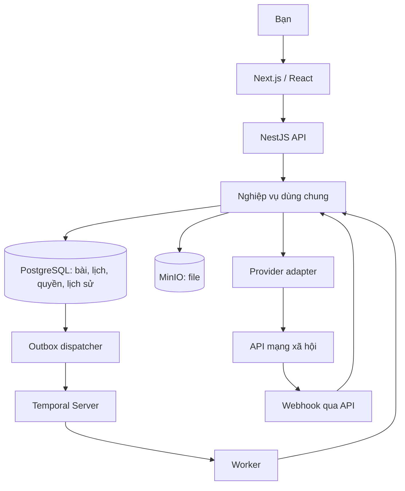

# Học kiến trúc Social Media Automation từng bước

Ghi chú học tập bằng tiếng Việt theo yêu cầu của bạn, ngày 15/11/2026.

## Cách đọc để không bị ngợp

Mỗi lần chỉ cần đọc một bài, khoảng 5–10 phút. Không cần nhớ hết tên công nghệ ngay. Cuối mỗi bài có một câu hỏi để tự kiểm tra; đáp án nằm ở cuối file.

Ví dụ xuyên suốt: **tải một ảnh, viết caption, hẹn đăng lên một Facebook Page lúc 9 giờ sáng ngày mai, rồi xem kết quả trong lịch sử.** Facebook Page là connector dự kiến, chưa được xác minh bằng tài khoản thật trong dự án.

Hiện repo chủ yếu có tài liệu, cấu trúc thư mục và công cụ phát triển. Ứng dụng, database và các dịch vụ local của mình chưa được scaffold để chạy luồng dưới đây. Đây là giải thích về thiết kế, không phải báo cáo chức năng đã hoạt động.

Lộ trình đọc:

1. [Bức tranh tổng thể](#bài-1-bức-tranh-tổng-thể).
2. [PostgreSQL và MinIO](#bài-2-postgresql-và-minio-lưu-hai-loại-dữ-liệu-khác-nhau).
3. [Nội dung, phiên bản và publication](#bài-3-nội-dung-phiên-bản-và-publication).
4. [API và nghiệp vụ](#bài-4-api-nhận-yêu-cầu-nghiệp-vụ-quyết-định).
5. [Transaction và outbox](#bài-5-transaction-và-outbox-giữ-yêu-cầu-không-bị-thất-lạc).
6. [Temporal và worker](#bài-6-temporal-nhớ-tiến-trình-worker-chạy-code).
7. [Đăng bài và xác minh](#bài-7-gửi-bài-chưa-chắc-đã-xác-nhận-được-bài).
8. [Module và layer](#bài-8-module-chia-theo-nghiệp-vụ-layer-chia-theo-trách-nhiệm-code).
9. [Thư mục và các công nghệ còn lại](#bài-9-đọc-cấu-trúc-thư-mục-và-nhận-diện-công-nghệ).

## Bài 1: Bức tranh tổng thể

Hình dung hệ thống như một đội làm việc:

| Thành phần       | Hình dung                           | Trách nhiệm                                        |
| ---------------- | ----------------------------------- | -------------------------------------------------- |
| Next.js + React  | Quầy làm việc của bạn               | Soạn bài, xem lịch và lịch sử.                     |
| NestJS API       | Nhân viên tiếp nhận                 | Nhận yêu cầu, xác định người dùng, gọi nghiệp vụ.  |
| Backend modules  | Các bộ phận chuyên môn              | Quyết định quyền, lịch đăng và cách xử lý kết quả. |
| PostgreSQL       | Sổ quản lý có cấu trúc              | Lưu nội dung, quyền, lịch, trạng thái và lịch sử.  |
| MinIO            | Kho file                            | Lưu ảnh, video và file được tạo thêm.              |
| Temporal         | Bộ điều phối công việc dài hạn      | Quản lý tiến trình, timer và phục hồi thực thi.    |
| Worker           | Người thực hiện công việc nền       | Chạy code workflow và activity.                    |
| Provider adapter | Người phiên dịch                    | Chuyển yêu cầu chung sang API từng nền tảng.       |
| Docker Compose   | Bản hướng dẫn dựng môi trường local | Khởi động và kết nối các dịch vụ phát triển.       |

Không phải mọi dữ liệu đều lần lượt đi qua PostgreSQL → MinIO → Temporal. Mỗi dịch vụ nhận loại dữ liệu phù hợp với trách nhiệm của nó.



Mũi tên từ PostgreSQL đến dispatcher nghĩa là dispatcher đọc các bản ghi outbox. Database không tự chạy code dispatcher. Trong sơ đồ này, các thao tác database và provider của worker đi qua nghiệp vụ và adapter.

**Tự kiểm tra:** Thành phần nào giữ file ảnh, thành phần nào giữ lịch đăng?

## Bài 2: PostgreSQL và MinIO lưu hai loại dữ liệu khác nhau

**PostgreSQL là cơ sở dữ liệu quan hệ.** Dữ liệu nằm trong các bảng có quan hệ và ràng buộc. Ví dụ: publication thuộc một người dùng và tham chiếu đến một phiên bản nội dung.

**MinIO là object storage**, kho lưu file dưới dạng object.

- **Bucket:** vùng chứa các object.
- **Object key:** tên xác định object trong bucket.
- **Metadata:** thông tin mô tả file.

Khi tải ảnh, thiết kế chia dữ liệu như sau:

```text
MinIO:
  bucket: media
  object key: organization-01/assets/image-123.jpg
  nội dung: dữ liệu thực tế của file ảnh

PostgreSQL — bản ghi media minh họa:
  mediaId: media-123
  storageKey: organization-01/assets/image-123.jpg
  mimeType: image/jpeg
  owner: organization-01
```

App đọc bản ghi trong PostgreSQL để biết ảnh thuộc ai và nằm ở đâu, rồi dùng adapter storage để truy cập file. Không cho phép tải file chỉ vì người gọi biết object key. Truy cập phải được kiểm soát, chẳng hạn bằng URL có thời hạn.

Upload vào MinIO và ghi PostgreSQL là hai thao tác riêng. Một transaction PostgreSQL không tự bao gồm MinIO. Tính năng upload cần xử lý trường hợp chỉ một bên thành công, ví dụ đánh dấu upload chưa hoàn tất và xử lý file mồ côi theo chính sách đã định.

**Tự kiểm tra:** Khi bạn đổi caption nhưng vẫn dùng ảnh cũ, có cần tải lại file ảnh không?

## Bài 3: Nội dung, phiên bản và publication

**Draft** là bản nháp đang chỉnh sửa. **Content version** là phiên bản nội dung cụ thể đã được lưu để tham chiếu chính xác.

```text
Bản nháp:
  version 1: “Ra mắt sản phẩm mới”
  version 2: “9 giờ sáng mai, ra mắt sản phẩm mới!”
```

Nếu bạn đã hẹn đăng version 1 rồi sửa draft thành version 2, publication vẫn phải giữ phiên bản đã chọn. Đổi nội dung sẽ đăng phải là hành động rõ ràng, được kiểm tra lại theo chính sách.

**Publication** là một lần dự định xuất bản một phiên bản nội dung đến một destination cụ thể.

Một nội dung gửi đến ba nơi tạo ba publication, để kết quả độc lập:

```text
Page A: published_confirmed
Page B: rejected
Nền tảng C: submitted_unverified
```

Các khái niệm liên quan:

| Khái niệm       | Ý nghĩa                                                         |
| --------------- | --------------------------------------------------------------- |
| Connection      | Kết nối và quyền app được một tài khoản bên ngoài cấp.          |
| Social identity | Danh tính thực hiện thao tác, chẳng hạn một Page.               |
| Destination     | Nơi nội dung được đưa đến, chẳng hạn feed của Page.             |
| Variant         | Biến thể caption hoặc nội dung dành cho một destination.        |
| Approval        | Quyết định duyệt gắn với đúng phiên bản, danh tính và nơi đăng. |

Kết nối thành công không có nghĩa được đăng ở mọi nơi. Sửa nội dung làm approval tương ứng mất hiệu lực. Duyệt nội bộ cũng khác với nền tảng bên ngoài đang chờ duyệt bài.

**Tự kiểm tra:** Đăng một nội dung đến ba nơi thì cần bao nhiêu publication? Vì sao?

## Bài 4: API nhận yêu cầu, nghiệp vụ quyết định

**React** xây các phần giao diện như ô caption, nút đăng và lịch. **Next.js** cung cấp cấu trúc ứng dụng web như trang, đường dẫn và layout, cùng các khả năng chạy phía server.

Khi bạn bấm hẹn giờ, dashboard gửi HTTP request đến API:

```text
Yêu cầu minh họa:
  contentVersionId: version-1
  identityId: page-a
  destinationId: page-a-feed
  scheduledAt: thời điểm đã chuẩn hóa
```

**NestJS** là framework tổ chức backend, cung cấp các thành phần như controller, module và dependency injection. Dependency injection nghĩa là truyền thành phần cần dùng vào nơi sử dụng, thay vì mỗi nơi tự tạo client riêng.

Luồng xử lý:

1. Presentation kiểm tra cấu trúc dữ liệu nhận vào.
2. Server xác định người đang đăng nhập.
3. Application kiểm tra quyền và điều kiện nghiệp vụ.
4. Application yêu cầu lưu dữ liệu qua một interface.
5. Presentation chuyển kết quả thành HTTP response.

Người gọi gửi `identityId = page-a` không chứng minh họ có quyền dùng Page A. Quyền phải được server xác minh.

**MCP** là một cửa vào khác để trợ lý AI gọi công cụ như tạo draft, hẹn đăng và xem trạng thái. HTTP và MCP gọi cùng nghiệp vụ, áp dụng cùng quyền. Một cờ “đã duyệt” do AI gửi không tự tạo ra approval hợp lệ.

**Tự kiểm tra:** Vì sao kiểm tra quyền chỉ ở giao diện là chưa đủ?

## Bài 5: Transaction và outbox giữ yêu cầu không bị thất lạc

Nếu làm hai việc riêng:

```text
Lưu lịch vào PostgreSQL
→ gọi Temporal
```

thì có thể gặp tình huống lịch đã lưu nhưng Temporal mất kết nối. Dashboard báo đã hẹn, trong khi chưa có workflow để thực hiện.

Thiết kế dùng **transactional outbox**:

```text
Trong cùng một PostgreSQL transaction:
  1. Tạo publication, trạng thái scheduled
  2. Tạo outbox: cần khởi động workflow cho publication này
```

**Transaction:** nhóm thay đổi cùng thành công hoặc cùng được hoàn tác.

**Outbox:** bản ghi bền vững mô tả công việc cần chuyển đi. Nó giữ ý định thực hiện ngay cả khi chưa gọi được Temporal.

**Dispatcher:** tiến trình nền đọc outbox và yêu cầu Temporal khởi động workflow. Khi khởi động lại, nó tiếp tục xử lý các bản ghi chưa hoàn tất.

Dispatcher dùng workflow ID ổn định, ví dụ `publish-publication-123`, và xử lý an toàn trường hợp workflow đã tồn tại. Điều này cần thiết khi workflow đã được khởi động nhưng dispatcher dừng trước khi đánh dấu outbox hoàn tất.

Hai thuật ngữ hữu ích:

- **Idempotency:** lặp lại cùng một yêu cầu không tạo thêm tác động ngoài ý muốn. Ví dụ cùng một idempotency key trả về publication đã tạo; nếu đổi nội dung nhưng giữ key thì báo xung đột.
- **Revision:** số phiên bản của lịch hoặc yêu cầu. Công việc cũ phải kiểm tra revision để không tiếp tục đăng theo lịch đã bị sửa.

Workflow ID không tự chống mọi trường hợp đăng trùng. Còn cần ràng buộc database, nhận việc nguyên tử và xử lý kết quả của provider.

**Tự kiểm tra:** PostgreSQL lưu thành công nhưng Temporal đang tắt thì điều gì giúp yêu cầu được chuyển lại sau đó?

## Bài 6: Temporal nhớ tiến trình, worker chạy code

Temporal giải quyết câu hỏi: **một công việc kéo dài nhiều giờ hoặc nhiều ngày tiếp tục thế nào sau khi tiến trình bị dừng?**

| Khái niệm       | Vai trò                                             | Ví dụ                                       |
| --------------- | --------------------------------------------------- | ------------------------------------------- |
| Temporal Server | Quản lý lịch sử thực thi, timer và phân phối task.  | Ghi nhận workflow đang chờ đến 9 giờ.       |
| Workflow        | Code mô tả thứ tự điều phối.                        | Chờ → kiểm tra → gửi → xác minh.            |
| Activity        | Thao tác có tác động ra bên ngoài.                  | Đọc database, gọi API, cập nhật trạng thái. |
| Worker          | Tiến trình chạy code workflow và activity của mình. | Thực hiện activity gửi bài.                 |

Workflow minh họa:

```text
Chờ đến thời điểm đăng bằng durable timer
→ gọi activity kiểm tra điều kiện hiện tại
→ gọi activity gửi bài
→ chờ và kiểm tra kết quả nếu cần
→ ghi nhận kết quả nghiệp vụ
```

**Durable timer** được Temporal quản lý bền vững, thay vì chỉ nằm trong RAM của worker. Worker tắt không làm mất lịch chỉ vì bộ nhớ tiến trình đã mất. Khi hạ tầng và worker hoạt động trở lại, việc xử lý có thể tiếp tục. Nếu dịch vụ ngừng lúc đến giờ, bài vẫn có thể bị đăng trễ; Temporal không thay thế yêu cầu vận hành ổn định.

**Replay** là cách Temporal dùng lịch sử thực thi để dựng lại tiến trình workflow. Code workflow phải **deterministic**: khi được chạy lại với lịch sử đó, các quyết định điều phối phải nhất quán. Vì vậy, gọi API, đọc database và thao tác file nằm trong activity, không nằm trực tiếp trong workflow.

Activity có thể được thực hiện nhiều lần. Temporal không tự bảo đảm một bài chỉ xuất hiện đúng một lần trên mạng xã hội. Application và adapter vẫn cần bảo vệ tác động bên ngoài.

Thiết kế dùng PostgreSQL cho cả ứng dụng và Temporal, nhưng tách database:

```text
application database
  → nội dung, publication, quyền, lịch sử sản phẩm

Temporal persistence database
  → dữ liệu thực thi và lịch sử do Temporal quản lý

Temporal Visibility database
  → dữ liệu phục vụ tra cứu execution
```

Ba database không đồng nghĩa bắt buộc ba máy chủ vật lý. Không trộn bảng Temporal với bảng nghiệp vụ của app.

**Tự kiểm tra:** Gọi API Facebook nên nằm trong workflow hay activity?

## Bài 7: Gửi bài chưa chắc đã xác nhận được bài

Đến giờ đăng, activity gọi application để kiểm tra lại quyền, lịch hiện tại, yêu cầu hủy và khả năng đăng. Kiểm tra lúc hẹn giờ chưa đủ vì các điều kiện có thể đã thay đổi.

**Provider adapter** chuyển yêu cầu chung của app thành yêu cầu riêng của từng nền tảng:

```text
Yêu cầu chung: đăng media-123 với caption X
  → Facebook adapter: thao tác API theo yêu cầu Facebook
  → LinkedIn adapter: thao tác API theo yêu cầu LinkedIn
```

Ảnh có thể được cung cấp bằng URL có kiểm soát hoặc được tải lên theo quy trình riêng, tùy API. Không giả định mọi nền tảng nhận file giống nhau.

Các trạng thái publication:

| Trạng thái             | Ý nghĩa                                                |
| ---------------------- | ------------------------------------------------------ |
| `scheduled`            | Đã lên lịch.                                           |
| `submitting`           | Đang gửi.                                              |
| `submitted_unverified` | Đã gửi hoặc có thể đã gửi, chưa xác minh được kết quả. |
| `pending_approval`     | Chờ duyệt từ nền tảng bên ngoài.                       |
| `published_confirmed`  | Có bằng chứng xác nhận đã xuất bản.                    |
| `rejected`             | Bị từ chối.                                            |
| `failed`               | Thất bại đã được xác định.                             |
| `cancelled`            | Đã hủy.                                                |

Đây không phải một đường thẳng mà bài nào cũng đi qua mọi trạng thái. Approval nội bộ được lưu riêng.

Tình huống quan trọng:

```text
Worker gửi yêu cầu
→ nền tảng nhận và đăng bài
→ mất kết nối trước khi worker nhận phản hồi
```

Timeout không chứng minh bài chưa đăng. Gửi lại ngay có thể tạo bài trùng.

**Reconciliation** là đối chiếu với nền tảng để làm rõ kết quả trước khi quyết định tiếp. Có thể dùng:

- **Read-back/polling:** chủ động gọi API để hỏi lại.
- **Webhook:** nhận sự kiện nền tảng gửi đến API của mình, khi có hỗ trợ phù hợp.

Webhook phải được xác minh, chống xử lý trùng và xử lý sự kiện đến muộn hoặc sai thứ tự. Nếu không đủ bằng chứng thì giữ trạng thái chưa rõ và yêu cầu can thiệp khi cần.

**Retry** là thử lại. Chỉ retry có giới hạn với lỗi đã biết là tạm thời và có thể thử an toàn. Có thể dùng backoff, tức tăng khoảng chờ giữa các lần thử. Không retry mù quáng một thao tác đăng có kết quả chưa rõ.

Lịch sử sản phẩm lưu trong PostgreSQL: giai đoạn, thời gian, lần thử, lỗi an toàn, workflow ID, correlation ID, provider ID/URL và bằng chứng. Correlation ID giúp nối các log của cùng một chuỗi xử lý. Temporal history giải thích quá trình thực thi, không thay thế lịch sử nghiệp vụ.

Hủy khi đang gửi cũng có thể cần đối chiếu: yêu cầu hủy không thể bảo đảm thu hồi thao tác nền tảng đã nhận. Facebook Page và Facebook Group là các capability khác nhau; kiểm chứng Page không chứng minh Group hoạt động.

**Tự kiểm tra:** API đăng bài bị timeout thì có nên lập tức gửi lại không?

## Bài 8: Module chia theo nghiệp vụ, layer chia theo trách nhiệm code

**Module** gom một nhóm nghiệp vụ. Module không tự động là một server riêng.

| Module       | Câu hỏi nó giải quyết                                          |
| ------------ | -------------------------------------------------------------- |
| Access       | Ai đang dùng app và được làm gì?                               |
| Connections  | Kết nối với tài khoản nào? Token còn hiệu lực không?           |
| Destinations | Có thể đăng ở đâu, dùng danh tính nào, hỗ trợ thao tác gì?     |
| Media        | File nằm đâu, thuộc ai, đã sẵn sàng chưa?                      |
| Content      | Caption, draft, phiên bản và biến thể là gì?                   |
| Publishing   | Khi nào đăng, cần duyệt không, kết quả và lịch sử ra sao?      |
| Engagement   | Đọc bình luận, soạn và gửi trả lời thế nào?                    |
| AI           | Sinh nội dung theo ngữ cảnh và chính sách thương hiệu thế nào? |
| Analytics    | Có số liệu nào, đo lúc nào và còn mới không?                   |

Tài liệu kiến trúc còn nhắc Integrations như nhóm trách nhiệm tích hợp. Quy tắc hiện tại đặt adapter trong module sở hữu nghiệp vụ: adapter đăng ở Publishing, adapter OAuth/token ở Connections, adapter MinIO ở Media. Tránh một global service ôm mọi nghiệp vụ của một provider.

**OAuth** là cơ chế để người dùng cấp quyền truy cập giới hạn cho app. Token là thông tin cho phép thực hiện các lời gọi đã được cấp quyền; phải lưu phía server, mã hóa khi lưu và tránh xuất hiện trong log.

AI không được tự vượt quyền hoặc tự phê duyệt hành động. Bình luận bên ngoài là dữ liệu không đáng tin; luồng trả lời cần tránh vòng lặp tự trả lời. Analytics phải phân biệt số 0 với số liệu chưa có, bị giới hạn quyền hoặc đã cũ.

Trong mỗi module backend, **layer** chia trách nhiệm code:

| Layer          | Trách nhiệm                                  | Ví dụ                                             |
| -------------- | -------------------------------------------- | ------------------------------------------------- |
| Domain         | Quy tắc nghiệp vụ thuần.                     | Đổi nội dung làm approval tương ứng mất hiệu lực. |
| Application    | Điều phối một hành động nghiệp vụ.           | Kiểm tra quyền rồi tạo lịch đăng.                 |
| Infrastructure | Giao tiếp với database và dịch vụ bên ngoài. | Ghi PostgreSQL, gọi Temporal hoặc provider.       |
| Presentation   | Nhận và chuyển đổi HTTP/MCP/webhook.         | Kiểm tra input, gọi use case, trả response.       |
| Composition    | Lắp ghép các implementation cụ thể.          | Truyền PostgreSQL repository vào use case.        |

**Use case** là một hành động nghiệp vụ như hẹn đăng hoặc hủy publication.

**Port** là interface mô tả khả năng application cần. **Adapter** là implementation làm việc đó bằng công nghệ cụ thể.

```text
Application: “Tôi cần lưu publication”
  → port mô tả thao tác lưu
  → PostgreSQL adapter triển khai thao tác đó
```

Domain và Application không import NestJS, SDK provider, Temporal hoặc database client. Nhờ vậy HTTP, MCP và worker dùng chung quy tắc; không mỗi nơi triển khai một kiểu.

**Tự kiểm tra:** Quy tắc “ai được hẹn đăng lên Page A” nên chỉ nằm trong HTTP controller hay nằm trong nghiệp vụ dùng chung?

## Bài 9: Đọc cấu trúc thư mục và nhận diện công nghệ

| Thư mục              | Vai trò                                                        |
| -------------------- | -------------------------------------------------------------- |
| `apps/web`           | Dashboard Next.js/React.                                       |
| `apps/api`           | HTTP, MCP, OAuth callback và webhook.                          |
| `apps/worker`        | Workflow, activity và dispatcher chạy nền.                     |
| `packages/backend`   | Nghiệp vụ dùng chung, port và adapter.                         |
| `packages/contracts` | Schema và kiểu dữ liệu gửi/nhận công khai.                     |
| `infra/local`        | Docker Compose và hướng dẫn local khi được triển khai.         |
| `infra/services`     | Cấu hình không chứa bí mật cho từng dịch vụ.                   |
| `scripts`            | Tự động hóa công việc phát triển.                              |
| `tests`              | Test tooling hiện có; test xuyên ứng dụng khi được triển khai. |
| `docs`               | Thiết kế, kế hoạch, hướng dẫn và quyết định.                   |
| `reference`          | Checkout bên ngoài để nghiên cứu, không import vào app.        |
| `.local`             | Log và file local tạm, được Git bỏ qua.                        |
| `.secrets`           | Cấu hình riêng chứa bí mật, được Git bỏ qua.                   |

Ví dụ vị trí code tương lai, chưa phải các file đã tồn tại:

```text
apps/api/src/presentation/http/publishing/
  → nhận yêu cầu hẹn đăng

packages/backend/src/modules/publishing/
  domain/
  application/use-cases/
  application/ports/
  infrastructure/
  → quy tắc, hành động nghiệp vụ và adapter

apps/worker/src/workflows/publishing/
  → điều phối chờ và thực hiện

apps/worker/src/activities/publishing/
  → gọi nghiệp vụ từ activity
```

Các khái niệm công cụ:

| Tên                | Giải thích                                                                                              |
| ------------------ | ------------------------------------------------------------------------------------------------------- |
| TypeScript         | JavaScript có kiểm tra kiểu khi phát triển; code được chuyển thành JavaScript để chạy.                  |
| Node.js            | Môi trường chạy JavaScript phía server. Root toolchain chọn 24.14.0.                                    |
| npm                | Quản lý thư viện và lệnh phát triển. Root toolchain chọn 11.21.1.                                       |
| Monorepo           | Nhiều app/package trong một repository. Không có nghĩa mọi app chạy cùng tiến trình.                    |
| npm workspaces     | Quản lý các package trong monorepo; kích hoạt khi có manifest ứng dụng thực tế, dùng một root lockfile. |
| Public contracts   | Thỏa thuận về cấu trúc request, response và lỗi mà web/API/MCP dùng.                                    |
| Runtime validation | Kiểm tra dữ liệu khi thực sự nhận vào; TypeScript không tự xác minh dữ liệu từ mạng.                    |
| Docker             | Chạy dịch vụ trong container từ image và cấu hình.                                                      |
| Docker Compose     | Mô tả, khởi động và nối các container cho môi trường local.                                             |
| Named volume       | Vùng dữ liệu được Docker quản lý để giữ dữ liệu ngoài vòng đời container. Không thay thế backup.        |
| Migration          | Thay đổi có phiên bản đối với cấu trúc database. Tooling database chưa được chọn.                       |
| CI                 | Kiểm tra tự động khi push hoặc mở PR. Hiện mới kiểm tra tooling của repo.                               |

Frontend dùng public contracts, không import backend internals hoặc giữ provider token. API và worker dùng chung backend nhưng không import source của nhau. Package không import từ app.

MinIO, PostgreSQL, self-hosted Temporal, Next.js/React, NestJS và Docker Compose đã được chọn theo quy tắc hiện tại. Một số tài liệu cũ còn dùng chữ “candidate”. Phiên bản dependency ứng dụng, công cụ truy cập database/migration, production hosting, sign-in provider và mục tiêu availability vẫn chưa chốt. Prisma chưa được chọn. Playwright là ứng viên cho kiểm thử giao diện và thí nghiệm browser, không phải luồng đăng Group đã được xác minh.

Self-hosting nghĩa là đội mình vận hành Temporal và database: cần backup, thử restore, giám sát, kiểm soát truy cập, nâng cấp và phục hồi sự cố trước production. Docker Compose local không chứng minh production có tính sẵn sàng cao.

Checkpoint local đầu tiên dự kiến dùng provider fake cho một bài text hẹn giờ, đi qua database/outbox/Temporal rồi hiển thị lịch sử. Fake giúp kiểm tra logic, không chứng minh connector thật hoạt động. Mốc provider thật đầu tiên vẫn là tài khoản test được cấp quyền, ảnh + caption, đăng ngay/hẹn giờ và xác nhận hoặc thể hiện rõ kết quả chưa chắc chắn.

**Tự kiểm tra:** Có code adapter và test giả lập thành công đã đủ để nói “Facebook chạy được” chưa?

## Ôn lại toàn bộ luồng

```text
1. Bạn tải ảnh và soạn caption trên dashboard.
2. Ảnh vào MinIO; metadata và nội dung vào PostgreSQL.
3. API xác định người dùng và gọi application kiểm tra quyền.
4. Application lưu publication và outbox trong một transaction.
5. Dispatcher đọc outbox, khởi động Temporal workflow.
6. Workflow chờ đến giờ bằng durable timer.
7. Activity gọi application kiểm tra lại quyền, revision và hủy.
8. Adapter giao tiếp với API mạng xã hội để gửi bài.
9. Hệ thống xác minh hoặc giữ kết quả chưa rõ để đối chiếu.
10. PostgreSQL lưu trạng thái/lịch sử; dashboard hiển thị cho bạn.
```

Khi đọc code sau này, hãy hỏi: **Ai nhận yêu cầu? Ai quyết định? Dữ liệu lưu đâu? Nếu tiến trình dừng thì phục hồi thế nào?**

## Đáp án tự kiểm tra

1. MinIO giữ file ảnh; PostgreSQL giữ lịch đăng.
2. Không cần chỉ vì caption đổi. Metadata và nội dung thay đổi độc lập với file ảnh đã có.
3. Ba publication, để mỗi destination có lịch sử và kết quả riêng.
4. Người gọi có thể bỏ qua UI và gửi request trực tiếp. Server phải kiểm tra quyền.
5. Outbox bền vững cùng dispatcher có cơ chế phục hồi và thử chuyển lại.
6. Trong activity. Workflow chỉ điều phối bằng code và API phù hợp với replay.
7. Không. Timeout có thể xảy ra sau khi provider đã nhận bài; cần đối chiếu và chỉ retry khi an toàn.
8. Trong application dùng chung, để HTTP, MCP và worker áp dụng cùng chính sách.
9. Chưa. Cần bằng chứng từ thao tác cụ thể trên tài khoản thật được cấp quyền và được phép kiểm thử.

## Tài liệu gốc để đọc thêm

- [README của dự án](../../README.md).
- [Thiết kế kiến trúc](../architecture/architecture-design.md).
- [Vị trí và ranh giới code](../workspace-layout.md).
- [Kế hoạch Content & Publishing](../plans/02-content-and-publishing.md).
- [Quy tắc dự án hiện tại](../../AGENTS.md).

Ghi chú này lưu phần giải thích để học dần. Tài liệu gốc và quy tắc dự án là nơi kiểm tra các quyết định hiện hành khi triển khai.
