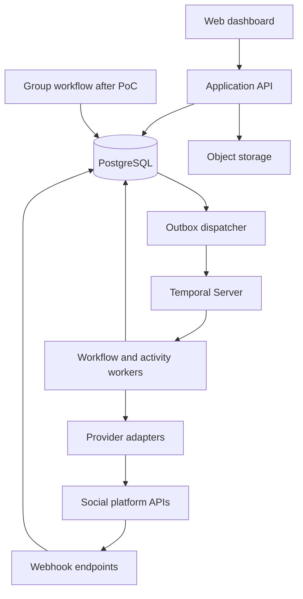

# Technical plan

Reviewed on 13 November 2026. Architecture direction and the Postiz publishing-adapter baseline are established; account-specific access, unresolved capabilities, and production sizing remain pending.

The workflow-level architecture, MCP contract, data model, and execution design are maintained in [architecture-design.md](../architecture/architecture-design.md).

The executable delivery sequence is maintained in the [five-stage roadmap](README.md), with separate plans for discovery/foundation, publishing, engagement/AI, analytics, and QA/internal rollout.

## Repository baseline

The local repository is `D:\Social_Media_Automation`, with origin `https://github.com/itsdabao/Social_Media_Automation.git`. It has an unborn `main` branch, root npm tooling and hook tests, CI definitions, self-contained project rules, and established app/package/documentation directories. Application source, package manifests, migrations, and our own runnable service configuration remain to be scaffolded.

The supplied handoff defines the workflows. Both current tracker exports contain five parent tasks and 21 other task records, including three records without task-level labels. Their parent relations and the two duplicate task titles are reconciled in the roadmap. Platform API access and production integrations still need live verification.

## Established publishing baseline and next work

The [platform capability baseline](../references/platform-capabilities.md) records Postiz publishing adapters for nine of our ten requested platform families, with Substack unresolved. The end-to-end source trace already covers scheduling, provider submission, pending processing, and recovery. This is sufficient implementation evidence to begin the foundation.

1. Select compatible application versions, database access, and explicit local identity behavior.
2. Scaffold the web/API/worker and shared packages, with isolated PostgreSQL/Temporal/MinIO local configuration.
3. Build one scheduled-publication flow against a provider fake with persisted attempts/history and outbox dispatch.
4. Prepare authorized test Page/developer-app access alongside local work; Facebook Page is the proposed first real connector.
5. Verify that connector's current requirements and live image/caption publishing/read-back, then expand operation-by-operation. Keep external Group and Substack gaps explicit.

Current official API compatibility and our access still require verification per connector. They do not require repeating the completed reference inventory or delaying unrelated local implementation.

## Proposed architecture

A TypeScript modular monolith with a web dashboard, HTTP API, and Temporal-backed workflow workers is the starting recommendation. API and workers share domain logic and provider adapters. Each process can run from the same repository and release. Temporal coordinates durable publishing workflows; PostgreSQL remains the source of truth for business records and user-facing statuses.

The application modules are accounts and authorization, media and content, destinations and publishing, comments and replies, and metrics. AI reply generation fits inside the reply workflow with explicit approval and publishing steps.

The Group PoC must determine whether the appropriate execution environment is a user-assisted browser, an extension, or an isolated worker. Its execution environment remains an open architecture decision.

## Proposed stack

TypeScript is the confirmed implementation language because it is the team's primary language. This applies to the dashboard, API, workers, MCP layer, and shared contracts. Root development tooling now pins Node.js 24.14.0 and npm 11.21.1. The npm monorepo layout is established in [workspace-layout.md](../workspace-layout.md). Exact application dependency versions remain open.

Inspection of `D:\Celestiny` confirmed that the team's local Celesnity web manifest declares Next.js 16.3.8, React 19.2.8, TypeScript 5.9.3, Tailwind CSS 4, Zustand 5, and Zod 4. Its App Router layout uses Next.js and React directly. The Core manifest declares NestJS 11.2.7, Prisma 7.9.1, PostgreSQL driver `pg`, and the MCP SDK. Its API and worker entry points use NestJS. These local source declarations support choosing Next.js/React and NestJS for team familiarity. Installed versions and runtime health were outside this inspection.

Celesnity informed the team convention comparison in [celesnity-conventions-reference.md](../references/celesnity-conventions-reference.md), and Postiz supplies social-provider source examples. Project rules are self-contained in the root AGENTS.md. Use npm workspaces for the application monorepo with one root lockfile when package manifests are scaffolded.

| Area                                    | Candidate                                             | Reason and condition                                                                                                                                                                                                                                  |
| --------------------------------------- | ----------------------------------------------------- | ----------------------------------------------------------------------------------------------------------------------------------------------------------------------------------------------------------------------------------------------------- |
| Language and workspace                  | TypeScript confirmed; npm monorepo layout established | Use the team's primary language and share provider types and API contracts across dashboard, API, and worker.                                                                                                                                         |
| Dashboard                               | Next.js and React                                     | Fits the composer, library, inbox, and history screens. Keep provider credentials within server execution.                                                                                                                                            |
| API and domain modules                  | NestJS                                                | Provides module boundaries, validation, dependency injection, and worker integration.                                                                                                                                                                 |
| Durable records                         | PostgreSQL                                            | Store publications, immutable content versions, attempts, authorization records, comments, and metric snapshots with relational constraints.                                                                                                          |
| Database access                         | Prisma candidate                                      | Evaluate migrations, transaction support, concurrency control, and required SQL against the chosen supported version before selection.                                                                                                                |
| Workflow execution                      | Self-hosted Temporal selected                         | Coordinate scheduled multi-destination publishing, pending-result checks, retries, recovery, and workflow history. Operate Temporal Server and PostgreSQL-backed persistence/visibility. Elasticsearch is not required for the planned configuration. |
| Media                                   | S3-compatible object storage; MinIO candidate         | Store binary assets with controlled upload and download access. Validate provider media-fetch requirements and URL lifetime.                                                                                                                          |
| Browser experiments and UI verification | Playwright candidate                                  | Useful for browser PoCs and application end-to-end checks. Session ownership and execution location depend on the Group PoC.                                                                                                                          |
| Internal application login              | Company identity provider, if available               | Confirm the team's existing sign-in setup. Application login and social account authorization have separate lifecycles.                                                                                                                               |
| AI replies                              | Provider SDK selected after reply-policy review       | Start with contextual draft generation and approval states. Model and orchestration framework remain open.                                                                                                                                            |
| Local runtime                           | Docker Compose candidate                              | Bring up application services, self-hosted Temporal, PostgreSQL, and MinIO reproducibly.                                                                                                                                                              |

Next.js documents its server/client boundaries. Temporal provides durable workflow execution and visibility, while the application still owns publication reconciliation and destination-level business state. [Next.js](https://nextjs.org/docs/app/getting-started/server-and-client-components), [Temporal workflows](https://docs.temporal.io/workflows), [Temporal Visibility](https://docs.temporal.io/visibility)

### Self-hosted Temporal deployment

Production includes Temporal Server, PostgreSQL-backed Temporal persistence and Visibility, and our application workers. The app retains a separate PostgreSQL business database and MinIO for media/extracted files. Elasticsearch is not required for the selected PostgreSQL Visibility configuration. Separate Temporal and app databases at minimum; separate database servers can isolate capacity and failure domains as production requirements justify. The team owns backups and restore exercises, monitoring/alerts, TLS and access control, upgrades, capacity planning, and recovery procedures. Set availability and recovery targets before sizing production. Local Compose can mirror this topology but does not provide high availability.

## Domain and reliability decisions to validate

- A connection records the authorizing user, scopes, expiry, and revocation state. A publishing identity represents the Page or profile. A destination represents the feed, Group, or community eligible for that identity.
- A master post has immutable content versions and destination-specific variants. Each publication captures the exact variant and identity used for one destination.
- Publication states include scheduled, submitting, submitted_unverified, pending_approval, published_confirmed, rejected, failed, and cancelled. Record attempts and timestamps separately so rescheduling and retries preserve history.
- Store the publication and an outbox entry in one database transaction. Start Temporal workflows from the outbox with stable workflow IDs and safe duplicate handling. Recover undispatched work after restart.
- Claim publication work atomically and reconcile provider results before retrying an ambiguous submission. Temporal workflow IDs must be combined with database constraints and provider-specific recovery behavior.
- Record provider post IDs and URLs when available. Capture webhook events durably, deduplicate them, and reconcile delayed or out-of-order updates with current provider state.
- Capability checks apply per operation, connection, identity, and destination. Publishing access, comment access, and metrics access require independent verification.
- Authorize internal users for connected identities and actions. Encrypt stored tokens, redact secrets from logs, and restrict browser-session access to the owning workflow.
- AI-generated replies pass through the same publication controls as human replies, including duplicate protection, approval, and loop prevention.
- Metric snapshots retain platform definitions, measurement time, and availability reasons such as permission denied or delayed data.

## Reference evaluation

### Postiz

The focused local source findings are recorded in [Postiz reference review](../references/postiz/reference-review.md), including publishing, Temporal recovery, MCP, storage, and gaps against our Group/inbox workflows. The [deep dive](../references/postiz/deep-dive.md) traces concrete calls through the source, and the [capability baseline](../references/platform-capabilities.md) inventories requested platform coverage.

The initial review inspected the repository overview, root dependency manifest, and top-level application/library directories. Observed technologies include Next.js, NestJS, Prisma, pnpm, and Temporal dependencies. The application directories include frontend, backend, orchestrator, and extension. The declared license is AGPL-3.0. [Repository](https://github.com/gitroomhq/postiz-app), [Manifest](https://github.com/gitroomhq/postiz-app/blob/main/package.json), [Applications](https://github.com/gitroomhq/postiz-app/tree/main/apps)

Use the completed source trace to guide provider contracts, OAuth/token refresh, media publishing, scheduling recovery, error handling, and publication read-back. Inspect the specific adapter again when implementing it and check current official requirements. Group, inbox, and AI capabilities retain their own verification work. Evaluate license obligations before source reuse.

The build-versus-adapt decision should consider required workflow coverage, app-approval requirements, operational footprint, maintainability, and the amount of custom code needed. Reference-project feature lists require confirmation through source and authorized live tests.

### Framework and provider references

- Use official provider documentation as the authority for supported endpoints, scopes, account types, and review requirements. Maintain the ten-platform findings in the API research task.
- Keep provider API calls in Temporal activities, and keep workflows deterministic and focused on orchestration. [Temporal workflows](https://docs.temporal.io/workflows), [Temporal worker deployment](https://docs.temporal.io/best-practices/worker)
- Verify database-access behavior against the selected Prisma release, especially transaction and concurrency requirements. [Prisma transactions](https://www.prisma.io/docs/orm/fundamentals/transactions)
- Use Playwright authentication guidance when handling browser test state. Authenticated state contains credentials and needs protected storage outside version control. [Playwright](https://playwright.dev/docs/auth)

## Decisions needed before application scaffolding

Select compatible application dependency versions, database access/migration tooling, and explicit local identity behavior before scaffolding the runnable foundation. Production hosting and company sign-in remain decisions to record before the corresponding deployment/integration work. The focused Postiz source trace already exists. Page/LinkedIn and external Group PoCs gate their actual connectors; pending external credentials do not block local provider-fake implementation. The first real provider slice still covers connection, image-and-caption publishing, read-back, and history on an authorized test destination.

## Verification scope

Completed repository inventory, selected Postiz/Celesnity source reviews, workspace organization, root tooling checks, and read-only comparison of the supplied tracker exports. The delivery plans cover all 21 task records. Application framework compatibility checks, live platform API calls, browser publishing tests, our application deployment validation, and Notion state inspection remain pending.
