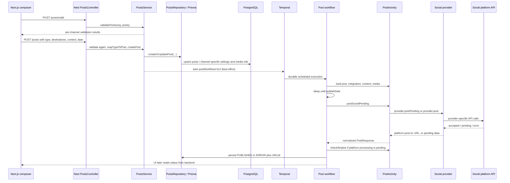

# Postiz source deep dive

Reviewed on 13 November 2026 against the local checkout at `reference/postiz-app`, commit `4823080b413b9d3dc625d466939eb43b9657c66c`.

This document follows the scheduled-post path through the source. It is an implementation map for learning and design comparison. It does not claim the connected platform APIs work with our credentials, and it is not a recommendation to copy Postiz wholesale.

## How to read the repository

Postiz is a `pnpm` monorepo. Its main runtime pieces are:

| Piece                        | What it does                                                                                                  | Start here                                                                                                     |
| ---------------------------- | ------------------------------------------------------------------------------------------------------------- | -------------------------------------------------------------------------------------------------------------- |
| `apps/frontend`              | Next.js / React dashboard. The post composer builds a post payload and calls the backend.                     | `src/components/new-launch/manage.modal.tsx`                                                                   |
| `apps/backend`               | NestJS HTTP API, auth/permission checks, MCP bootstrap, and app wiring.                                       | `src/api/routes/posts.controller.ts`, `src/app.module.ts`                                                      |
| `apps/orchestrator`          | NestJS process that runs Temporal workflow and activity workers.                                              | `src/workflows/post-workflows/post.workflow.v1.1.2.ts`, `src/activities/post.activity.ts`, `src/app.module.ts` |
| `libraries/nestjs-libraries` | Shared Nest modules, Prisma repositories/services, provider adapters, MCP tools, storage, and Temporal setup. | `src/database/prisma/posts/`, `src/integrations/`, `src/temporal/`                                             |
| `libraries/helpers`          | Shared formatting, content, and utility code.                                                                 | `src/utils/`                                                                                                   |

The root manifest owns most dependencies and scripts. The workspace packages use `apps/*` and `libraries/*`. The checked-out root manifest pins Node `22.23.4` and pnpm `10.6.1`; do not infer the runtime from the `volta` entry, which says Node `20.17.0`.

## One post, from composer to platform

### 1. The composer prepares one entry per destination

`manage.modal.tsx` collects editor values and emits channel-specific objects: integration id, channel settings, one or more content entries, media references, tags, and publish date. It first calls `POST /posts/valid` so the user can correct settings or content before saving. It then sends separate requests for `update`, `schedule`, `now`, and `draft`; this allows a single composer save to treat channels differently.

The browser validation is useful feedback, not a security boundary. The controller repeats validation on the server. That is why changing or bypassing the UI does not remove the server checks.

### 2. The controller establishes the organization and checks the request

`PostsController.createPost` obtains the organization from the authenticated request, checks the create/monthly-post policy, calls `validatePosts`, rejects empty content, and applies provider validity, content-error, and maximum-length rules for non-drafts. It then maps the input to `CreatePostDto` and delegates to `PostsService.createPost` with creation method `WEB`.

The Nest app installs a global `ValidationPipe`, auth/permission guards, throttling, and exception filters in `apps/backend/src/main.ts` and `app.module.ts`. The route's organization context is important: a channel id supplied by the client is not treated as proof that the channel belongs to that organization.

### 3. The application service applies channel rules and saves the post

`PostsService.createPost` handles each requested destination. It checks that edited post ids do not belong to a different organization, protects published posts from accidental republishing, selects the provider adapter, optionally strips links or creates shortlinks, and calls `PostsRepository.createOrUpdatePost`.

The repository stores a separate `Post` record for each destination. A record has `organizationId`, `integrationId`, content, `publishDate`, `state`, serialized provider settings, serialized media references, and release id/URL fields. `batchId` links posts created together for several destinations. `group` and `parentPostId` link editor entries such as threads/comments. These fields are not the same thing as a social network's own Group or community.

For `draft`, the saved state is `DRAFT` and no publish workflow is started. For `schedule` and `now`, the saved state is `QUEUE`; `now` maps the scheduled date to the current time. `update` changes an existing not-yet-published post without starting another workflow. The app-level state enum is comparatively small: `DRAFT`, `QUEUE`, `PUBLISHED`, and `ERROR`.

In the inspected repository method, content entries are upserted in a loop. The excerpt does not show the whole multi-channel save wrapped in one database transaction, so don't assume that one composer action is atomic across every destination.

### 4. The service starts a workflow for the saved record

For non-update records, `PostsService.createPost` calls `startWorkflow` without awaiting it; it attaches a catch handler and continues returning the create response. `startWorkflow` looks for an existing running execution for the post, tries to terminate it, skips drafts, then starts `postWorkflowV112` with workflow id `post_<postId>` and Temporal search attributes for `postId` and `organizationId`.

This is where Postiz draws the boundary: PostgreSQL stores the business post and current status; Temporal stores execution history and timers. The workflow reloads the business record through activities rather than treating the workflow input as the full content record.

There is no transactional outbox in this inspected path. Because workflow start errors are caught and suppressed, the API can return success after the database save even when Temporal did not start the workflow. The recurring `missingPostWorkflow` is a recovery sweep: it finds old queued posts and uses `signalWithStart` to create or poke a workflow. That improves recovery, but it is not equivalent to atomically recording dispatch intent with the business write.

### 5. Temporal waits until the scheduled time and coordinates provider work

`postWorkflowV112` loads the post, rejects missing/deleted or no-longer-queued posts, then sleeps until `publishDate`. Temporal's durable timer means the worker does not need to sit in a JavaScript timer for days. After waking, the workflow reloads the post chain and checks the connected account's state before attempting to publish.

The orchestrator registers workflow code on the `main` task queue and activity workers on provider-specific queues. `getTemporalModule(true, ...)` creates the worker set. Provider concurrency limits can be divided across replicas, and selected queues can be pinned with `EXCLUDE_QUEUE`. This is a real scaling choice in this implementation: orchestration is separated from provider side effects, and provider rate/concurrency pressure can be bounded.

The workflow code uses Temporal workflow APIs such as `sleep`, signals, child workflows, and activity proxies. External calls, Prisma/database writes, token refresh, and notifications belong in activities. That split is essential because workflow code must replay deterministically.

### 6. Activities turn the generic workflow request into a provider call

`PostActivity.postSocialPending` loads the registered provider via `IntegrationManager`, refreshes or handles credentials, normalizes content/media, and calls the provider's `postPending` method when available or its ordinary `post` method otherwise. It runs in a Temporal activity so timeouts, retries, and failure details are tracked separately from the workflow's decision logic.

The shared `SocialProvider` contract combines several provider capabilities: OAuth/authentication, refresh, content and media validation, publishing, optional comments, analytics, and settings metadata. Concrete adapters live beside each other in `integrations/social/*.provider.ts`, and `IntegrationManager` registers them in `socialIntegrationList`.

This makes provider support discoverable and lets generic application code ask for capabilities, but it also creates a broad interface and places provider adapters in the shared Nest library. For our design, the reusable idea is a stable provider contract plus adapters; the cleaner boundary is to keep platform SDK details behind those adapters and expose smaller operations to application/workflow ports.

### 7. Some platforms need an asynchronous processing phase

For providers that return `status: 'pending'`, the workflow does not call publish again. It calls the provider's read-only `checkPostStatus` activity and waits on Temporal timers between checks. A provider may return `pending`, `ready`, or `completed`. `ready` allows a final mutation such as setting a thumbnail; the provider contract requires that `finalizePost` become safe against unknown outcomes so an activity retry cannot duplicate the mutation.

This design handles a common social API pattern: upload/initiate first, wait for transcoding or platform processing, then finalize and obtain the public URL. `pendingData` is provider-owned and opaque to generic workflow code.

### 8. The workflow treats unknown results as a duplicate-post risk

The workflow classifies failures such as token refresh, explicit provider rejection, timeout, and unknown errors. If Temporal times out while a publishing mutation may have reached the platform, Postiz marks the post `ERROR`, notifies the user that the result is unconfirmed, and tells them to check the destination before manually reposting. It avoids blindly repeating a mutation after acceptance or an uncertain timeout.

After success, the activity writes `PUBLISHED`, platform release id, and URL back to PostgreSQL. The workflow sends notifications/webhooks and can run follow-up plugs or spawn a repeat-post child workflow. The calendar/history UI then reads the state from the backend; it is not the authority for whether the platform accepted the post.

## MCP takes the same business path

`IntegrationSchedulePostTool` obtains organization context from the authenticated MCP request, resolves each integration within that organization, uses `PostsService.validatePosts`, then calls the same `PostsService.createPost` path with creation method `MCP`. It returns post ids and preview URLs. Thus MCP and the dashboard are separate input/transport layers, but they converge on shared validation and persistence logic.

The reusable product pattern is **one application operation, several authorized entry points**. MCP should not get a private publishing implementation that bypasses the dashboard's policies or provider rules.

## What this code teaches us, and what we should design differently

| Postiz pattern                                                      | Useful lesson                                                                                      | Our design decision                                                                                           |
| ------------------------------------------------------------------- | -------------------------------------------------------------------------------------------------- | ------------------------------------------------------------------------------------------------------------- |
| One persisted post per destination                                  | Failures and provider settings differ by channel.                                                  | Keep publication status and attempts independently queryable per destination.                                 |
| Provider-specific settings and validation                           | Each network has distinct media/content requirements.                                              | Validate on the server through adapter capabilities; the UI only assists.                                     |
| Temporal timers plus workflow/activity split                        | Scheduling and long-running uploads need durable orchestration.                                    | Use self-hosted Temporal from the start, and keep side effects in activities.                                 |
| Pending/status/finalize contract                                    | Some APIs accept an upload before they finish processing it.                                       | Model submission, processing, confirmation, and uncertainty explicitly.                                       |
| Unknown publish result marked unconfirmed                           | A timeout does not prove the platform rejected the post.                                           | Reconcile before retrying; don't promise exactly-once publication.                                            |
| Same `PostsService` used by MCP                                     | Different transports should share policy and business rules.                                       | HTTP and MCP call the same application services.                                                              |
| Save followed by best-effort workflow start                         | A DB commit and Temporal start can disagree.                                                       | Use a PostgreSQL transactional outbox and an idempotent dispatcher.                                           |
| Compact `ERROR` state                                               | A single state can hide whether failure was validation, platform rejection, or uncertain delivery. | Keep structured attempts, provider error class, and `submitted_unverified` as distinct status.                |
| Broad provider interface in shared Nest library                     | One registry makes capabilities easy to find.                                                      | Keep narrow application ports and provider-specific infrastructure adapters.                                  |
| `settings`, `image`, and some connection data serialized as strings | Flexible provider-specific data can evolve quickly.                                                | Keep typed domain fields and JSON only at well-defined provider/config boundaries; protect tokens separately. |

## Suggested source-reading route

Read these in order, following each call rather than opening the whole monorepo randomly:

1. `apps/frontend/src/components/new-launch/manage.modal.tsx` — payload construction, validation request, save request.
2. `apps/backend/src/api/routes/posts.controller.ts` — authenticated HTTP boundary and server-side checks.
3. `libraries/nestjs-libraries/src/database/prisma/posts/posts.service.ts` — validation, create/update rules, Temporal start.
4. `libraries/nestjs-libraries/src/database/prisma/posts/posts.repository.ts` and `schema.prisma` — persisted shape and status.
5. `libraries/nestjs-libraries/src/temporal/temporal.module.ts`, `apps/orchestrator/src/app.module.ts` — worker/task queue registration.
6. `apps/orchestrator/src/workflows/post-workflows/post.workflow.v1.1.2.ts` — durable orchestration and error handling.
7. `apps/orchestrator/src/activities/post.activity.ts` — side-effect bridge into services and adapters.
8. `libraries/nestjs-libraries/src/integrations/integration.manager.ts`, `social/social.integrations.interface.ts`, one concrete provider — adapter registry and provider contract.
9. `libraries/nestjs-libraries/src/chat/tools/integration.schedule.post.ts` — MCP path into the same application service.
10. `libraries/nestjs-libraries/src/temporal/infinite.workflow.register.ts` and `apps/orchestrator/src/workflows/missing.post.workflow.ts` — queued-post recovery sweep.

## Review limits

This pass traced source and configuration only. It did not install dependencies, run the app, execute tests, or call social-network APIs. The reference checkout was clean at the reviewed commit. Treat current branches/tags and external API behavior as unverified until checked again.
