# Postiz reference review

Reviewed on 12 November 2026 against local reference commit `4823080b413b9d3dc625d466939eb43b9657c66c` at `reference/postiz-app`.

This is a focused source review of publishing, provider contracts, MCP, persistence, storage, and workflow recovery. Findings describe the checked-out implementation. Provider access and runtime behavior require live validation.

## Architecture observed

| Area                 | Observed implementation                                                                                      | Main source                                                                                                                   |
| -------------------- | ------------------------------------------------------------------------------------------------------------ | ----------------------------------------------------------------------------------------------------------------------------- |
| Frontend             | Next.js scripts and React, with root-managed dependencies and pnpm workspaces.                               | `apps/frontend/package.json`, root `package.json`                                                                             |
| HTTP API             | NestJS controllers invoke shared services.                                                                   | `apps/backend/src/api/routes/posts.controller.ts`                                                                             |
| Background execution | NestJS orchestrator hosts Temporal workflows and activities.                                                 | `apps/orchestrator/src/workflows/post-workflows/post.workflow.v1.1.2.ts`, `apps/orchestrator/src/activities/post.activity.ts` |
| Shared backend       | Services, repositories, adapters, DTOs, and infrastructure live together under `libraries/nestjs-libraries`. | `libraries/nestjs-libraries/src/`                                                                                             |
| Database             | Prisma 6.5.0 declared in the root manifest, PostgreSQL datasource.                                           | `libraries/nestjs-libraries/src/database/prisma/schema.prisma`                                                                |
| MCP and agent        | Mastra tool definitions and MCP server, backed by existing application services.                             | `libraries/nestjs-libraries/src/chat/start.mcp.ts`                                                                            |
| Storage              | Local disk or Cloudflare R2 selected through a factory. R2 implementation uses AWS S3 SDK.                   | `libraries/nestjs-libraries/src/upload/upload.factory.ts`, `cloudflare.storage.ts`                                            |

The root `CLAUDE.md` describes the frontend as Vite React. The actual frontend manifest runs `next dev`, `next build`, and `next start`. The source manifest supplies the stronger evidence for current frontend tooling.

The development Compose file includes PostgreSQL, Redis, Temporal, a separate Temporal PostgreSQL service, Elasticsearch, and administrative UIs. Publishing uses Temporal workflows. Redis's presence alone does not establish a BullMQ publishing implementation.

## Publishing flow traced

```mermaid
flowchart TD
    UI[Dashboard HTTP request] --> Controller[PostsController]
    Controller --> Service[PostsService]
    MCP[MCP scheduling tool] --> Validate[Shared post validation]
    Validate --> Service
    Service --> Repo[PostsRepository]
    Repo --> DB[(PostgreSQL through Prisma)]
    Service --> Temporal[Start postWorkflowV112]
    Temporal --> Wait[Wait until publish date]
    Wait --> Activity[PostActivity]
    Activity --> Provider[SocialProvider implementation]
    Provider --> Network[Platform API]
    Temporal --> Results[Update state and notify]
```

`PostsService.createPost` loops over requested channel posts, persists them through `createOrUpdatePost`, and starts the corresponding workflow. MCP's `IntegrationSchedulePostTool` validates content/settings/media through `PostsService.validatePosts`, then calls `createPost` with creation method `MCP`. It supports draft, scheduled, and immediate posts and returns preview links.

Post records belong to integrations and organizations. `batchId` associates channel posts created together. `group` associates editor/thread records, while `parentPostId` chains post/comment records. Content settings and media are serialized into string columns in the reviewed write path. This structure differs from our proposed immutable content-version and per-destination publication records.

## Provider design

`SocialProvider` combines authorization, refresh, validation, publishing, outbound comments, optional analytics, media constraints, and destination-selection methods. The manager registers concrete providers and returns metadata for UI/agent use.

The pending-publication contract separates submission, status checks, and finalization. `PendingCheckResponse` represents pending, ready, or completed. Provider-specific `pendingData` stays opaque to generic workflow logic. The interface explicitly describes finalization recovery behavior needed to avoid duplicate mutations.

The checked-out registry constructs 35 provider variants across social networks, publishing platforms, chat tools, and community services. For our requested platform families, it registers Facebook, LinkedIn member and Page, Medium, X, Instagram and Instagram Standalone, TikTok and TikTok Business, Threads, Bluesky, and Reddit. Substack is absent from the registry and provider source directory. This proves implementations are wired into Postiz, not that OAuth credentials are valid, platform approval is granted, or endpoints work against live accounts. Several providers also use different auth models (OAuth, API key/app password, or manually configured credentials), so “connect API” is not one uniform flow.

The source-level connector check is summarized below:

| Platform family | Registry/provider code                   | Source evidence for connection/publishing path                                      | Live account verified |
| --------------- | ---------------------------------------- | ----------------------------------------------------------------------------------- | --------------------- |
| Facebook        | Present                                  | OAuth/Page discovery, token refresh, post and pending/finalize paths                | No                    |
| Instagram       | Present (OAuth and standalone variants)  | Account discovery, refresh, media publishing and pending/finalize paths             | No                    |
| LinkedIn        | Present (member and Page variants)       | Separate member/Page auth and publish implementations; member pending/finalize path | No                    |
| X               | Present                                  | OAuth/provider client, publish and pending/finalize paths                           | No                    |
| TikTok          | Present (standard and Business variants) | Publish and status-check paths; visibility can be environment-hidden/migrated       | No                    |
| Threads         | Present                                  | OAuth, publish and pending/finalize paths                                           | No                    |
| Bluesky         | Present                                  | Credential/session handling and publish/status/finalize paths                       | No                    |
| Reddit          | Present                                  | OAuth, publish and pending/finalize paths                                           | No                    |
| Medium          | Present                                  | Token/API integration and publish path                                              | No                    |
| Substack        | Not found                                | No registered provider implementation found in checked-out source                   | No                    |

This is a presence/path audit, not a correctness or security audit. It does not establish current API compatibility, app-review approval, granted scopes, media format acceptance, refresh behavior against real grants, or successful publication/read-back. A real end-to-end connector check needs configured provider app credentials, authorized test accounts, and a low-risk test post for each platform. No credentials or live API calls were used for this review.

The Facebook adapter discovers managed Pages through `/me/accounts`, publishes photos/feed content, and sends outbound comments through a Graph comments endpoint. The inspected code and searches did not establish external joined-Group publishing or Profile-based Group execution.

## Important terminology for our requirements

| Reference term                                 | Meaning established in inspected code                            | Implication                                                                                 |
| ---------------------------------------------- | ---------------------------------------------------------------- | ------------------------------------------------------------------------------------------- |
| MCP `groupList`                                | Customer groups used to filter integrations.                     | Facebook Group discovery remains a separate feature.                                        |
| `Post.group`                                   | Internal grouping of related editor/thread records.              | Our destination model needs explicit external Group IDs and identity eligibility.           |
| Prisma `Comments` and preview comment endpoint | Feedback on post previews, including anchored text and replies.  | Incoming social comment synchronization requires its own model and ingestion flow.          |
| Provider `comment()`                           | Publish a supplied comment/reply, used by post/thread workflows. | An outbound operation alone leaves inbox synchronization and AI reply controls to validate. |

## Recovery behavior worth studying

The reviewed workflow treats mutation activities differently from read-only checks. Publishing/finalization activities disable automatic Temporal activity retry and use deliberate workflow-level handling. Pending checks run with durable timers, and providers can finalize after processing completes.

`markUnconfirmed` records `ERROR` and creates a notification telling the user to check the account before reposting. The persisted post-state enum contains `QUEUE`, `PUBLISHED`, `ERROR`, and `DRAFT`. Our richer publication states would preserve ambiguous submission and external approval explicitly in queryable records.

The mutation workflow classifies heartbeat timeout without heartbeat details as retryable. That heuristic deserves failure-injection review because the activity may execute an external side effect before its first heartbeat arrives. Our design should reconcile provider acceptance whenever the outcome is uncertain.

`PostsService.createPost` persists data before calling `startWorkflow`, and the reviewed path suppresses workflow-start errors. A missing-post sweep attempts recovery with `signalWithStart`. This creates a persistence/dispatch recovery dependency worth understanding before adapting the implementation. Our selected Temporal design uses a PostgreSQL transactional outbox to retain workflow-start intent alongside publication state.

## Media and environment configuration

`UploadFactory.createStorage` accepts `local` and `cloudflare`. `CloudflareStorage` constructs `https://<accountID>.r2.cloudflarestorage.com` as its endpoint. MinIO integration would need explicit configuration/adapter work in this checkout. Its current factory offers no `minio` selection.

The storage interface and streaming/upload mechanisms are useful references. Optional media normalization and clipping are gated on Cloudflare configuration and external RunPod services. Those dependencies would need evaluation against our desired media features.

The `.env.example` combines base infrastructure, application URLs, social app credentials, storage, email, MCP OAuth, payments, and optional AI/media services. Treat it as a configuration inventory. Inspect each selected feature's code to determine which values our application needs. The Cloudflare-required comment and local-storage default need feature-specific validation during setup.

## MCP implementation

`startMcp` loads shared agent tools, builds Mastra MCP servers, and wires authenticated HTTP endpoints and widget resources. Authentication resolves organization context through application OAuth or API-key paths. Endpoint variants customize tool exposure for different clients.

The scheduling tool declares its mutation/non-idempotent hints, validates attachments and channel settings, resolves the integration within organization scope, and calls the same posting service used by other entry points. Its annotations describe behavior to clients. Server authorization and approval controls still need dedicated review before reuse.

For our system, keep the shared-service pattern, exact content/destination previews, explicit approval policy, and idempotent submit contracts. Choose MCP transport/SDK versions through a compatibility test. Mastra adoption remains a separate decision.

## Fit and recommended use

Postiz is a strong source reference for composer/channel settings, OAuth identity selection, provider validation, media publishing, pending processing, and MCP-to-service integration. Celesnity remains the primary reference for team conventions and dependency boundaries.

A full Postiz fork would inherit Temporal orchestration and a broader SaaS domain including organizations, subscriptions, billing, marketplace, and client integrations. Our app will use Temporal too, but the business model, delivery-state records, and workflow recovery should follow our requirements. Facebook Group distribution, incoming social inbox coverage, and AI auto-reply policy still need independent validation.

The provisional recommendation is a focused TypeScript application using Celesnity conventions, with Postiz informing provider and workflow design. Our current architecture direction selects self-hosted Temporal; Postiz's implementation remains a useful workflow reference, not proof that its provider integrations work with our accounts. A full build-versus-adapt estimate requires deeper provider, authorization, UI, and operations review.

The root license is AGPL-3.0. Individual package manifests use differing license labels. Establish applicable reuse obligations from the repository license and intended use before importing code.

## Verification scope

Read local guidance, manifests, example environment configuration, development Compose, provider interfaces/registry, Facebook publishing/comment methods, selected LinkedIn method locations, Prisma models, post creation/repository paths, latest publishing workflow excerpts, missing-post recovery, MCP bootstrap, scheduling tool, customer-group tool, and preview-comment implementation. Recorded the reference commit and observed a clean reference working tree.

No dependencies were installed, application services started for connector checks, tests executed, platform APIs invoked, or provider grants validated. This review covers source presence and selected connector paths, not end-to-end correctness. A complete security audit and exhaustive feature inventory remain pending.
