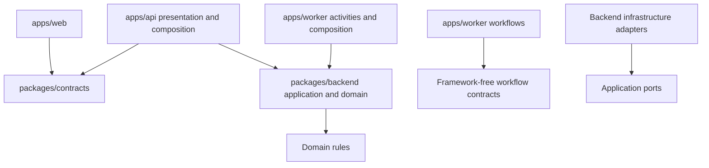

# Workspace layout

Established on 13 November 2026 before application scaffolding. Directory roots exist now; the deeper source paths below are placement examples to create when their feature is implemented. Application manifests, framework versions, database client, and service configuration are still pending.

## Repository shape

```text
Social_Media_Automation/
  README.md
  AGENTS.md
  package.json
  package-lock.json
  .github/workflows/        GitHub CI definitions
  .husky/                  Local Git hooks
  apps/
    web/                   Next.js UI
    api/                   NestJS request handlers and API startup
    worker/                Temporal workflow/activity hosts and dispatcher
  packages/
    backend/               Domain, application operations, ports, adapters
    contracts/             Public request/response schemas and transport types
  infra/
    local/                 Local Compose and safe environment examples
    services/              PostgreSQL, Temporal, MinIO service configuration
  scripts/                 Repository/developer automation
  tests/
    tooling/               Existing hook regression tests
    e2e/                   Future tests spanning API, worker, and web
  docs/
    architecture/
    plans/
    guides/
    references/
      postiz/
    decisions/
  reference/               Ignored external checkouts
  .local/                  Ignored local artifacts
  .secrets/                Ignored credentials and private configuration
  .task-checks/            Ignored disposable verification fixtures
```

Root configuration applies across the repository. Use npm workspaces for `apps/*` and `packages/*` with one root lockfile when package manifests are introduced. Directory READMEs mark the current boundaries; they do not make these packages runnable.

## File placement by responsibility

| File or concern                         | Future canonical location                                                                  | Responsibility                                                        |
| --------------------------------------- | ------------------------------------------------------------------------------------------ | --------------------------------------------------------------------- |
| Calendar route                          | `apps/web/src/app/(workspace)/calendar/page.tsx`                                           | Route composition and rendering.                                      |
| Composer UI                             | `apps/web/src/features/publishing/components/publication-composer.tsx`                     | Client interaction and presentation.                                  |
| Publication API client                  | `apps/web/src/features/publishing/api/publications.client.ts`                              | HTTP calls using public contracts.                                    |
| Shared button                           | `apps/web/src/components/ui/button.tsx`                                                    | Reusable UI primitive.                                                |
| HTTP controller / request DTO           | `apps/api/src/presentation/http/publishing/`                                               | Parse request, resolve caller, invoke use case, map result.           |
| MCP scheduling handler                  | `apps/api/src/presentation/mcp/publishing/`                                                | Translate MCP input into the same scheduling use case.                |
| OAuth callback                          | `apps/api/src/presentation/http/connections/`                                              | Handle the callback boundary and invoke connection logic.             |
| Provider webhook                        | `apps/api/src/presentation/webhooks/facebook/`                                             | Verify and normalize provider ingress.                                |
| Nest providers and modules              | `apps/api/src/composition/` and `apps/worker/src/composition/`                             | Wire concrete dependencies.                                           |
| Publication states and transition rules | `packages/backend/src/modules/publishing/domain/`                                          | Pure business values and decisions.                                   |
| Schedule/cancel/confirm operation       | `packages/backend/src/modules/publishing/application/use-cases/`                           | Permission, transaction, and business orchestration.                  |
| Repository interface                    | `packages/backend/src/modules/publishing/application/ports/publication.repository.port.ts` | Persistence operations required by the application.                   |
| PostgreSQL repository                   | `packages/backend/src/modules/publishing/infrastructure/persistence/`                      | Implement the persistence port.                                       |
| Provider publication adapter            | `packages/backend/src/modules/publishing/infrastructure/providers/facebook/`               | Translate provider publishing requests and outcomes.                  |
| Token refresh/connection adapter        | `packages/backend/src/modules/connections/infrastructure/providers/facebook/`              | Connection-specific provider operations.                              |
| MinIO object store adapter              | `packages/backend/src/modules/media/infrastructure/storage/`                               | Store and retrieve controlled media objects.                          |
| Temporal client adapter                 | `packages/backend/src/modules/publishing/infrastructure/temporal/`                         | Start/signal executions behind an application port.                   |
| Publish workflow                        | `apps/worker/src/workflows/publishing/publish-publication.workflow.ts`                     | Deterministic Temporal control flow and timers.                       |
| Publish activity handler                | `apps/worker/src/activities/publishing/submit-publication.activity.ts`                     | Thin bridge from Temporal to an application operation.                |
| Outbox dispatcher host                  | `apps/worker/src/dispatchers/outbox.dispatcher.ts`                                         | Poll/wake and invoke the shared outbox application operation.         |
| Public scheduling schema                | `packages/contracts/src/publishing/schedule-publication.schema.ts`                         | Validate public HTTP/MCP data without backend imports.                |
| Workflow input/result types             | `packages/backend/src/modules/publishing/application/contracts/`                           | Framework-free internal execution contracts.                          |
| Database schema / SQL migrations        | `packages/backend/database/`                                                               | Application persistence schema, ordered migrations, local/test seeds. |
| Compose topology                        | `infra/local/compose.yaml`                                                                 | Run local dependencies when implemented.                              |
| Service bootstrap configuration         | `infra/services/<service>/`                                                                | Non-secret service settings and initialization definitions.           |
| Developer helper                        | `scripts/<task>.mjs`                                                                       | Short automation that calls project operations.                       |
| Implementation plan                     | `docs/plans/<feature>.md`                                                                  | Acceptance conditions and bounded implementation steps.               |

These examples establish ownership, not an instruction to create every directory or file immediately. Feature modules such as `publishing`, `connections`, and `media` are created as their behavior is implemented. Put permission checks in the owning application operation so HTTP, MCP, and workers use the same policy.

## Backend module structure

```text
packages/backend/
  database/                Application schema and migrations, once selected
  src/
    modules/
      publishing/
        domain/            States, values, pure rules
        application/
          use-cases/       Scheduling, submitting, confirming, cancelling
          ports/           Narrow persistence/provider/execution interfaces
          contracts/       Internal operation inputs and results
        infrastructure/
          persistence/     PostgreSQL implementations
          providers/       Platform publishing implementations
          temporal/        Temporal client implementations
    shared/                Small framework-free primitives used by real modules
  tests/
    integration/           Adapter/database integration tests
```

Keep feature ownership even when one provider appears in several modules. Publication and connection adapters have different responsibilities; avoid a growing global provider service that owns every use case. Introduce a genuinely shared vendor client only after concrete duplication warrants it. Avoid generic `utils/`, `common/`, or `services/` dumping grounds.

## Dependency direction



- The dashboard imports public contracts and UI code. It never imports backend clients, tokens, workflow code, or domain internals.
- Controllers and activity handlers call application operations. They do not call database/provider SDKs directly.
- Domain and application layers do not import NestJS, Prisma, PostgreSQL drivers, Temporal, environment access, or vendor clients.
- Infrastructure implements application ports. API/worker composition selects those implementations.
- Temporal workflow modules may import Temporal workflow APIs and framework-free types/helpers that are safe to bundle and replay. They must not import activity implementations, NestJS, database code, or provider clients.
- Public contracts have no dependencies on apps, backend internals, or server credentials. Map transport data at entry boundaries.
- Packages never import from `apps/`. API and worker never import each other's source.
- Each package declares deliberate exports during scaffolding. Avoid reaching into another package's private `src/` files.

## Tests and fixtures

| Scope                                     | Location                                                 |
| ----------------------------------------- | -------------------------------------------------------- |
| Pure rule or use-case unit test           | Beside owning source as `*.test.ts`.                     |
| Backend adapter/database integration test | `packages/backend/tests/integration/<module>/`.          |
| Worker workflow/replay test               | `apps/worker/tests/workflows/`.                          |
| API boundary integration test             | `apps/api/tests/integration/`.                           |
| Web component test                        | Beside component as `*.test.tsx`.                        |
| Test spanning multiple applications       | Root `tests/e2e/`.                                       |
| Git hook/tooling regression               | Existing `tests/tooling/`.                               |
| Synthetic fixture                         | Next to the test or in its owning `fixtures/` directory. |

Use disposable databases and provider fakes for automated tests. Keep live provider checks explicitly authorized and distinguish them from fake-provider coverage. Tests that create temporary Git repositories continue using ignored `.task-checks/`.

## Configuration, generated output, and local data

Commit safe `.env.example` templates beside the runtime that consumes them: the app directory for an app and `infra/local/` for Compose. The startup commands must document how those files are loaded. Real `.env` files and `.secrets/` remain ignored.

Compose should use named volumes for PostgreSQL and MinIO data. Use ignored `.local/` for development exports, logs, and temporary artifacts. Database migrations are source and remain tracked under the backend package, not inside `.local/` or infrastructure volumes.

Build output stays with its package as `dist/` or `.next/`. Put generated OpenAPI clients and other generated source in an explicitly named `generated/` directory in the owning package when generation is introduced; document its source, regeneration command, and tracking policy then. Do not manually edit generated files.

The ignored `reference/postiz-app/` retains its own Git repository, dependencies, and local preview setup. Our app must not import from it. Human-readable source findings belong under `docs/references/`.

## First implementation boundary

Start with a text-only scheduled publication against a local provider fake, following the same application ports that a real adapter will implement. Add one request, database/outbox write, Temporal execution, persisted status/history, and a minimal UI that reads it. This is the first development checkpoint; the agreed first real provider slice still includes an authorized test account, image/caption, immediate/scheduled publishing, and confirmation or visible uncertainty.

Add concrete files only as each step requires them. README placeholders are replaced or updated as runnable packages and infrastructure are introduced.
